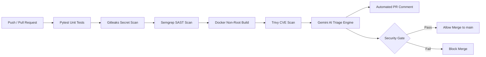

# DevSecOps AI Security Pipeline

[](https://github.com/chaiebchaher-gif/DevSecOps_ai_pipeline/actions/workflows/devsecops.yml)


Automated, self-defending **DevSecOps CI/CD pipeline** for a containerized **FastAPI** service. Every Pull Request and push to `main` runs multi-layer security scanning and feeds raw JSON reports into a custom **Python AI Security Triage Engine** powered by **Google Gemini** to post prioritized remediation guidance directly on Pull Requests.

## Architecture Flow



## Security Controls & Gates

| Stage | Tool | Purpose | Enforcement Policy |
| :--- | :--- | :--- | :--- |
| **1. Unit Tests** | `Pytest` | Validates FastAPI endpoints and AI triage report parsers | Must pass (`exit 0`) |
| **2. Secret Detection** | `Gitleaks` | Scans Git history and commits for leaked API keys or tokens | Fail on any secret |
| **3. SAST Analysis** | `Semgrep` | Detects insecure Python patterns (`p/python`, `p/security-audit`) | Fail on rule violations |
| **4. Container Hardening** | `Docker` | Builds `python:3.12-slim` image running as non-root `appuser` | Built per commit SHA |
| **5. Vulnerability Scan** | `Trivy` | Scans OS packages and Python dependencies (`--ignore-unfixed`) | Fail on fixable `CRITICAL`/`HIGH` CVEs |
| **6. AI Security Triage** | `security/ai_triage.py` | Aggregates JSON findings, calls Gemini API (with deterministic fallback), and comments on PRs | Posts/updates PR summary |
| **7. Branch Protection** | `GitHub Rules` | Requires `test-and-scan` status check before merging to `main` | Enforced for all users |

## Live Verification Examples

* **Blocked Vulnerable PR ([PR #1](https://github.com/chaiebchaher-gif/DevSecOps_ai_pipeline/pull/1)):** Introduced an unsafe `eval()` call in `app/main.py`. Semgrep caught the flaw, the AI Triage bot commented the exact file/line remediation, and Branch Protection locked the **Merge** button.
* **Approved Clean PR ([PR #2](https://github.com/chaiebchaher-gif/DevSecOps_ai_pipeline/pull/2)):** Verified `0` actionable findings across all scanners, posted a green merge recommendation, and merged cleanly into `main`.

## Local Usage

```bash
# Run unit tests (API + AI triage parser tests)
.venv/bin/python -m pytest -v

# Run AI triage engine against local scanner JSON reports
.venv/bin/python security/ai_triage.py reports/ triage-summary.md
```
